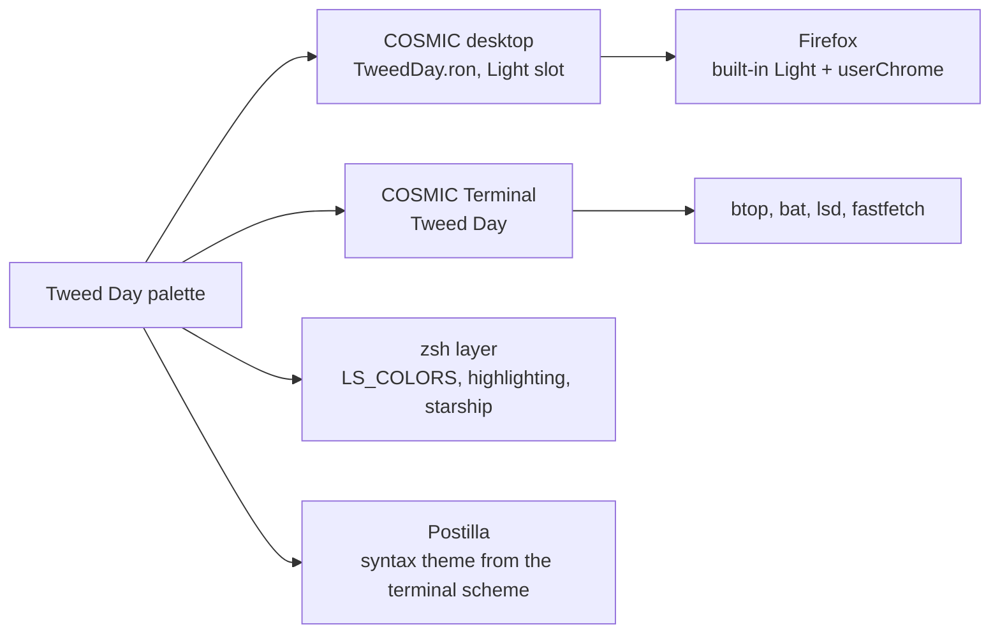

# Tweed Day

> Linen, flint and tan, with brick kept for what is wrong. Wool, wood and a record by daylight.

Pop!_OS 24.04 on the COSMIC desktop, one palette carried through the whole
machine: desktop, terminal, shell, editor, browser. This note is the rice
describing itself, written in Markdown and rendered by **Postilla**.

## Palette

Every text colour is checked against the window background  `#E9E6E2`.

| Role | Hex | Contrast on background |
|------|-----|------------------------|
| Text |  `#2C2E34` | 10.9:1 |
| Tan, accent |  `#76593D` | 5.2:1 |
| Salmon, warning |  `#A13A2B` | 5.3:1 |
| Brick, error |  `#B32A19` | 5.2:1 |
| Moss, success |  `#58644F` | 5.0:1 |
| Cream, symlinks |  `#695F3B` | 5.1:1 |
| Olive, directories |  `#586350` | 5.1:1 |
| Muted |  `#655F58` | 5.1:1 |

Containers sit one step away from the background at  `#F6F4F1`, which is
what frosted glass blurs into.

## Where the colours go



## Setup, in order

- [x] Import `cosmic/TweedDay.ron` into Appearance, **Dark** slot
- [x] Import `cosmic-term/TweedDay-term.ron`, pick **Tweed Day** for the profile
- [x] `./icons/install.sh` for the **Cosmic-TweedDay** icons, `./cosmic/install.sh` for fonts and the terminal look
- [x] `./zsh/install.sh`, `./lsd/install.sh`, `./fastfetch/install.sh`
- [x] Cursor: Oxygen-TweedDay-Tan
- [x] Wallpaper: `backgrounds/tweedday-anime.png`
- [ ] Screenshot for the README

## The baseline every rice shares

```ron
corner_radii: (
    radius_xs: (2.0, 2.0, 2.0, 2.0),   // squared corners
    radius_xl: (2.0, 2.0, 2.0, 2.0),
),
frosted: Low,
frosted_windows: true,
frosted_panel: true,
frosted_applets: true,
frosted_maximized_apps: false,
gaps: (0, 7),
active_hint: 1,
```

Contrast is the WCAG ratio[^1], where $L$ is relative luminance:

```typst
$ (L_1 + 0.05) / (L_2 + 0.05) >= 4.5 $
```

---

*Rendered in Postilla, a Markdown notes app for COSMIC. The window is painted
with this rice's terminal scheme, imported as a syntax theme.*

[^1]: Web Content Accessibility Guidelines, success criterion 1.4.3. Normal text wants 4.5:1, large text 3:1.
